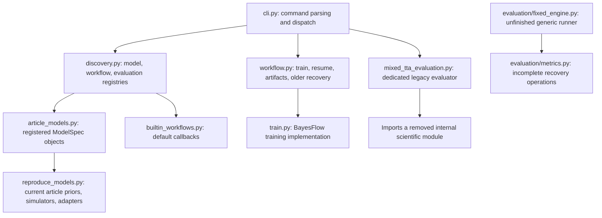
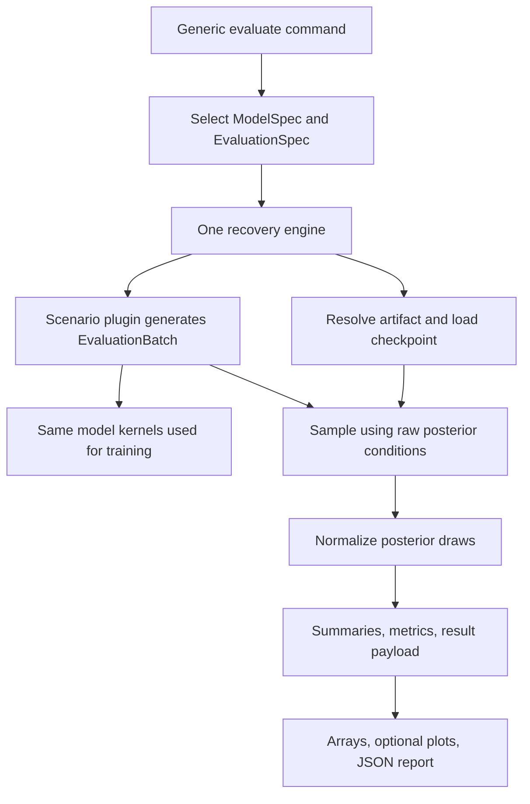

# Code structure and completion map

Reviewed: 23 October 2026.

This is a map of the current working tree and a guide for completing it yourself. It distinguishes existing behavior from proposed work. It does not claim that every existing module works, and it does not change the Python implementation.

The project goal is a reusable CLI through which a cognitive model developer supplies a prior, simulator, and data/condition encoding, then trains a model, saves a checkpoint, evaluates recovery, and performs real-data inference. Mixed TTA is one scientific application of that machinery. Docker will distribute the working application with its dependencies.

**Implementation update:** Step 1's numerical functions and deterministic tests are now implemented in `bayesflow_models/evaluation/metrics.py` and `tests/test_recovery_metrics.py`. The evaluation engine and CLI have not yet been connected to these functions. Continue with Step 2 after reviewing the commented implementation. Keep the present file layout while you make one complete recovery path work.

## 1. Why the repository feels confusing

Several generations of implementation coexist:

1. Old experiment-specific scripts and workflows.
2. The current plugin-based training/resume CLI.
3. A partly completed generic evaluation system, with two competing runners.

In particular, `workflow.py` and `workflow_trialwise.py` are different generations. Likewise, ordinary CLI recovery, the dedicated mixed-TTA evaluator, and the new generic evaluation runner are currently separate execution paths.

The environment checks and 25 tests reported earlier establish a useful baseline. They do not establish that the unfinished generic runner or the real mixed-TTA implementation works. The mixed-recovery CLI test substitutes a fake evaluation module, so it tests routing rather than the scientific implementation.

## 2. The current execution map

The console command is declared in [pyproject.toml](../pyproject.toml) as `bayesflow-cli = "cli:main"`.



The last arrow describes the intended integration: `fixed_engine.py` does not yet call the recovery functions. The CLI also does not yet dispatch its evaluation registry to that engine.

There are currently three recovery routes to reconcile:

| Route | Current call path | Decision |
| --- | --- | --- |
| Ordinary recovery | CLI `recovery` → selected workflow's `recovery_fn` → `workflow.recovery_from_artifact()` for the built-in workflow | Preserve temporarily; later route the built-in operation through the generic engine. |
| Mixed-TTA recovery | CLI `mixed-recovery` → `mixed_tta_evaluation.py` | Replace with a registered scenario using the generic engine. |
| Generic evaluation | `evaluation/fixed_engine.py::run_evaluation()` | Complete this as the supported recovery engine and connect it to the CLI. |

## 3. Existing files: what each owns

### Package infrastructure

| Existing file | Responsibility | Work needed |
| --- | --- | --- |
| [cli.py](../cli.py) | Parse commands, build runtime configuration, discover plugins, dispatch operations. | Add generic evaluation listing/execution; make errors readable; propagate supported options consistently. Keep metrics and model equations out of this file. |
| [bayesflow_models/interfaces.py](../bayesflow_models/interfaces.py) | `ModelSpec`, `Workflow`, `WorkflowContext`, `WorkflowResult`, callback types. | Align `ResumeFn` and `RecoveryFn` with actual supported callback signatures. The CLI currently calls both with `(spec, config)`, which disagrees with their annotations. Later document observation/condition schema compatibility. |
| [bayesflow_models/discovery.py](../bayesflow_models/discovery.py) | Discover model, workflow, and evaluation plugins; build `PluginRegistry`. | Retain `discover_plugins()` as the single discovery pass. Make older convenience discovery functions delegate to it, preserving their documented return types. Test evaluation registration and duplicate `(model_name, scenario_name)` rejection. |
| [bayesflow_models/builtin_workflows.py](../bayesflow_models/builtin_workflows.py) | Register the built-in workflow. | Keep. Update its recovery callback only when the generic replacement is ready. |
| [bayesflow_models/workflow.py](../bayesflow_models/workflow.py) | Build models from specs; resolve artifacts and aliases; construct output paths; write metadata; orchestrate training, resume, and older recovery. | Reuse artifact helpers now. Later replace duplicated recovery execution with delegation. Record reproducibility and compatibility facts in metadata. Split artifact helpers into a separate module only if needed after the first complete path works. |
| [bayesflow_models/train.py](../bayesflow_models/train.py) | Build networks and the BayesFlow workflow, fit online, save/reload checkpoints. | The active generic workflow calls `train_amortizer_resume()`. Make it honor the requested device; clarify training budget units; distinguish new training from resume; verify optimizer restoration and fresh-process loading. |
| [pyproject.toml](../pyproject.toml) and [uv.lock](../uv.lock) | Package metadata, console entry point, dependencies, accelerator selection, exact dependency resolution. | Preserve pins while establishing behavior. Add a tested Python pin, finish author/license metadata, and verify a built wheel in a clean environment. |
| [bayesflow_models/__init__.py](../bayesflow_models/__init__.py) | Package import boundary. | Later expose a small documented public API without eagerly importing the entire training stack. |

Two training defects matter before you call a workflow portable:

- `train.py` chooses CUDA automatically rather than receiving the resolved device from the CLI/workflow.
- `n_sim` is passed as `num_batches_per_epoch`, although some comments describe a number of simulations. Choose and document one meaning, then update configuration, CLI help, and metadata together. Resume's parsed `--n-sim` also needs propagation in `cli.py::build_runtime_config()`.

### Generic evaluation: your immediate working area

| Existing file | Keep, complete, or retire? | Exact responsibility |
| --- | --- | --- |
| [evaluation/interfaces.py](../bayesflow_models/evaluation/interfaces.py) | Keep; document. | `EvaluationSpec` declares a named scenario for a model. Its `generate_batch(model_spec, options)` returns an `EvaluationBatch` containing posterior conditions, separate truths, and scenario metadata. |
| [evaluation/metrics.py](../bayesflow_models/evaluation/metrics.py) | Step 1 implemented and tested. | Normalize posterior shapes, summarize draws, compare summaries with truths, and build numerical recovery results. These are pure functions with explanatory docstrings and comments. |
| [evaluation/fixed_engine.py](../bayesflow_models/evaluation/fixed_engine.py) | Complete as the single runner. | Resolve and validate the artifact, generate/validate a batch, load the checkpoint, sample, call recovery operations, save outputs, and return a report. |
| [evaluation/reporting.py](../bayesflow_models/evaluation/reporting.py) | Reuse selected functions; consolidate duplicates. | Keep array persistence and plotting here. Use the envelope builder already in `fixed_engine.py`; retire the competing report builder after migration. Choose one owner for output-directory creation. |
| [evaluation/runner.py](../bayesflow_models/evaluation/runner.py) | Retire after the supported runner works. | This is a competing unfinished implementation. Transfer useful ideas rather than repairing and maintaining both runners. |
| [evaluation/__init__.py](../bayesflow_models/evaluation/__init__.py) | Keep. | Currently exports the two evaluation dataclasses. Add public exports only when their contracts are stable. |

### Current article model workspace

| Existing file | Current role | Recommended treatment |
| --- | --- | --- |
| [article_models.py](../examples/article_workspace/plugins/article_models.py) | Registers `model_DC`, `model_DF`, and `model_SF`. | Keep as the article's model declaration. The active declarations import `reproduce_models.py`. Remove commented old registrations after choosing the supported scientific versions. |
| [reproduce_models.py](../examples/article_workspace/plugins/reproduce_models.py) | Supplies the priors, simulators, adapters, and BayesFlow simulator objects used by the active registrations. | Use this as the starting point for shared training/evaluation kernels. Make design and RNG inputs explicit without silently changing equations. |
| [reproduce_models_utility.py](../examples/article_workspace/plugins/reproduce_models_utility.py) | Contains additional or alternative scientific formulations. | Preserve as a distinct research variant until its intended equations and registration are decided. Similar names do not establish equivalence. |
| [workflow_builtin.py](../examples/article_workspace/plugins/workflow_builtin.py) | Registers `builtinExternal`, which points to the same package callbacks as the built-in workflow. | Optional custom-workflow example. The active article specs select `builtin`, so this file is not required for those models. |
| [DDM_DC_Pedestrain.py](../examples/article_workspace/plugins/DDM_DC_Pedestrain.py), [DDM_DC_Pedestrain_TrialWise.py](../examples/article_workspace/plugins/DDM_DC_Pedestrain_TrialWise.py), [models.py](../examples/article_workspace/plugins/models.py), [models_add_conditions.py](../examples/article_workspace/plugins/models_add_conditions.py) | Older scientific implementations outside the currently active article registrations. | Keep as research references until you establish whether any results depend on them. Move to a clearly labeled legacy location later if appropriate. |

The scientific files belong in the researcher workspace. The reusable engine should not import DDM equations, TTA levels, or participant-specific CSV column names.

## 4. The target recovery architecture



There are three owners:

- **Engine:** execution, checkpoint identity, validation, paths, and report persistence.
- **Reusable recovery operations:** posterior shape conventions, bias, RMSE, coverage, and summaries.
- **Scenario plugin:** experimental design, simulated observations, known parameters, and scientific interpretation.

Keep `EvaluationSpec.generate_batch()` focused on data generation. Do not add an arbitrary evaluator callback merely to finish parameter recovery. Future posterior predictive checks and real-data inference may need different input contracts because they do not always have ground-truth parameters.

## 5. Implementation order, with completion criteria

### Step 1 — Make posterior shapes explicit

**Edit:** [metrics.py](../bayesflow_models/evaluation/metrics.py).

**Tests:** [tests/test_recovery_metrics.py](../tests/test_recovery_metrics.py), now implemented.

Use this internal convention:

```text
N = datasets; S = posterior draws; P = model parameters

true_parameters[name]       -> (N,)
normalized_posterior[name]  -> (N, S)
summary[name][statistic]    -> (N,)
```

Implemented functions, in reading order:

```python
normalize_posterior_draws(
    *, posterior_samples, parameter_names, n_datasets, n_posterior_samples
)
summarize_posterior_draws(*, normalized_draws, lower=0.025, upper=0.975)
compute_recovery_metrics(*, normalized_draws, true_parameters)
build_recovery_result_payload(*, metrics)
```

These are the implemented interfaces. `compute_recovery_metrics()` now accepts normalized draws; the obsolete `runner.py` still contains a call using the previous interface and is not a supported execution path. The supported engine will call the new functions in Step 2.

Implemented behavior and remaining integration check:

- The installed BayesFlow sampler documents dataset/draw axes in that order. Verify an actual checkpoint's return value when integrating the engine in Step 2.
- Replace unrestricted `np.squeeze()`. Remove only explicitly supported singleton feature axes.
- Accept canonical `(N, S)` arrays, including square arrays where `N == S`; do not guess whether axes should be transposed.
- Accept `(N, S, 1)` only if you explicitly support that representation. Reject unsupported layouts with a useful error.
- Validate target shapes before flattening. Explicitly accepting `(N, 1)` is reasonable; flattening arbitrary arrays can hide errors.
- Check parameter keys, dataset counts, draw counts, and finite numerical values.
- Compute bias, RMSE, posterior mean/spread, and interval coverage. Use `None` for undefined correlation.
- Keep large arrays outside the JSON payload. Reject non-finite JSON numbers at persistence boundaries, for example with `allow_nan=False`.

**Done when:** hand-calculated fixtures pass for normal input, `N=1`, `S=1`, `N=S`, missing parameters, mismatched counts, empty draws, and invalid values. No filesystem or BayesFlow model loading is needed for these tests.

### Step 2 — Complete the engine and output contract

**Edit:** [fixed_engine.py](../bayesflow_models/evaluation/fixed_engine.py), [reporting.py](../bayesflow_models/evaluation/reporting.py), and [test_fixed_engine.py](../tests/test_fixed_engine.py).

Tasks:

1. Keep the existing artifact resolution and model/scenario identity checks.
2. Strengthen `validate_evaluation_batch()`: reject zero-dimensional conditions cleanly, validate finite truths, and document which condition fields must carry a leading dataset dimension. Finiteness and dtype checks for observations should follow the declared model schema.
3. Validate execution options before expensive work. In particular, reject nonpositive counts and booleans used as integer counts.
4. Keep `approximator.sample(conditions=..., num_samples=...)` keyword-based. Pass raw conditions through the checkpoint's adapter once. Test sampling without true parameter fields in the condition dictionary.
5. Normalize draws, summarize them, compute metrics, and assign `result_payload`. This is the missing section of `run_evaluation()`.
6. Save truths and summaries as well as posterior draws. Optionally save generated conditions, or a stable reference to them, for reproduction.
7. Give every invocation an evaluation ID. A suitable output pattern is `results/<artifact_id>/evaluations/<scenario>/<evaluation_id>/`.
8. Use one report envelope and one output-directory helper. Record the resolved options, scenario seed, model version, parameter order, and actual output paths.
9. Write and return the report. Make plotting optional so numerical recovery can complete without a display.

In `reporting.py`, the older `build_evaluation_report()` calls `datetime.now()` after importing the `datetime` module. Retiring this duplicate builder avoids keeping that defect and two report formats. Verify the plotting helper against installed BayesFlow 2.0.8 before integrating it.

**Done when:** a deterministic engine test traverses the complete runner and checks saved arrays/report contents, and a real checkpoint can pass through the same runner. Tests should also establish that repeated invocations do not overwrite each other.

### Step 3 — Supply a small reference model

**Add:** `examples/gaussian_workspace/plugins/gaussian_models.py`, `examples/gaussian_workspace/plugins/gaussian_evaluations.py`, and `tests/test_evaluation_integration.py`.

Tasks:

- Define a small Gaussian model with a known analytic posterior.
- Register its `ModelSpec` and an `EvaluationSpec` that returns an `EvaluationBatch`.
- Train briefly, save a checkpoint, load it in a fresh process, and run the actual recovery engine.
- Verify parameter names, shapes, finite results, and all output files.
- Use a separate, sufficiently trained validation run to compare posterior moments with the analytic answer under justified tolerances.

**Done when:** generic evaluation works for a model unrelated to DDM/TTA. A tiny execution test establishes plumbing; it does not need to claim accurate posterior learning after minimal training.

### Step 4 — Connect the engine to the CLI

**Edit:** [cli.py](../cli.py), [discovery.py](../bayesflow_models/discovery.py), [test_cli_models.py](../tests/test_cli_models.py), and [test_discovery.py](../tests/test_discovery.py).

Proposed commands, not yet implemented:

```text
bayesflow-cli evaluations list
bayesflow-cli evaluate --artifacts RUN_REFERENCE --scenario SCENARIO_NAME
```

Tasks:

- List model/scenario pairs from `registry.evaluations`.
- Resolve the artifact's model, then select `(model_name, scenario_name)` from that registry.
- Dispatch to the single engine and display the resulting report location.
- Pass execution options explicitly. Select a documented configuration mechanism for scenario-specific options so the generic CLI does not accumulate TTA-only flags.
- Report unknown artifacts, missing scenarios, and invalid inputs with a nonzero exit status and useful messages.
- Make built-in ordinary recovery delegate to the same engine using a default model-generated batch. A compatibility wrapper may preserve the older command while callers migrate.

**Done when:** the real Gaussian scenario runs through the installed CLI, and CLI tests cover successful routing and invalid selections.

### Step 5 — Implement mixed TTA as a scenario

**Edit:** [reproduce_models.py](../examples/article_workspace/plugins/reproduce_models.py) and, only as needed, [article_models.py](../examples/article_workspace/plugins/article_models.py).

**Add:** `examples/article_workspace/plugins/article_evaluations.py` and `tests/test_mixed_tta_scenario.py`.

The current core [mixed_tta_evaluation.py](../bayesflow_models/mixed_tta_evaluation.py) imports a removed internal model module and hard-codes a four-parameter scientific model. The active `model_DC` registration uses seven parameters from `reproduce_models.py`. Fixing only the import would not resolve that scientific mismatch.

Tasks:

- Choose and document the authoritative model version and equations before extracting kernels.
- Make the training wrapper and evaluation generator call the same simulation kernels.
- Use an explicit RNG owned by the scenario; do not assume reseeding NumPy's global RNG resets existing module-level `default_rng()` instances.
- Sample one parameter vector per participant/dataset, then simulate all that participant's trials using it.
- Validate TTA levels, trial counts, ordering/shuffling, jitter rules, observations, and covariate alignment.
- Return the checkpoint's expected raw input schema, with truths stored separately.
- Register homogeneous and mixed-design scenarios through `EVALUATIONS` or `register_evaluations()`.
- Record whether an evaluation matches training design or tests generalization to a changed design.

The present `meta()` selects one nominal TTA and 60 trials per dataset. Trial-level jitter is not equivalent to training on a dataset containing several nominal TTA conditions. For intended mixed-trial real-data use, train and validate the supported condition compositions and trial counts.

**Done when:** mixed TTA runs through the generic CLI and engine, uses the correct model kernels, and has no separate recovery metrics or checkpoint-loading implementation.

### Step 6 — Consolidate legacy paths

**Edit:** [workflow.py](../bayesflow_models/workflow.py), [builtin_workflows.py](../bayesflow_models/builtin_workflows.py), [interfaces.py](../bayesflow_models/interfaces.py), and callers/tests affected by migration.

Retire the competing evaluation runner and dedicated mixed-TTA execution only after their supported behavior is available through the generic path. Search imports before moving or deleting files. Preserve scientific reference implementations and document any intentionally unsupported old commands.

Do not combine this step with a wholesale `src/` migration, dependency upgrades, or changes to DDM equations. Each deserves its own verification.

**Done when:** supported recovery commands share one execution path, and the package core no longer depends on article-specific scientific modules.

## 6. What to defer, and what must eventually be finished

### Real-data inference

Existing reference: [utils_real_data.py](../bayesflow_models/utils_real_data.py).

Proposed supported module: `bayesflow_models/inference.py`, with a later CLI `infer` command.

The current helper infers separately by condition, then concatenates draws or averages summaries. Those operations do not compute the joint posterior for a subject's shared parameters. It also applies an adapter before calling the approximator, which needs reconciliation with the checkpoint's own adaptation behavior.

Implement one inference call over all supported trials for a subject. Validate the observation features, covariates, units, missing-data rules, and checkpoint schema. Reuse checkpoint loading and posterior normalization, but do not invent ground-truth parameters to fit the recovery batch contract.

Add `tests/test_inference.py`: simulator-generated data should travel through the real-data interface without truth fields or duplicate adaptation, and agree with direct inference for the same inputs and controlled randomness.

### Reliable training and artifacts

Finish device propagation, training budget semantics, and strict resume behavior in `train.py`, `workflow.py`, and `cli.py`. Resume should fail clearly when its required checkpoint is absent rather than silently train a new model. Record resolved configuration, seeds, model/schema versions, and relevant dependency versions in metadata.

Add `tests/test_training_integration.py` to verify save/load/resume in fresh processes. Establish and document whether optimizer state is preserved or reset. Do not infer correctness merely from the existence of a `.keras` file.

### Package verification

Build a wheel using the existing packaging configuration. Install it in a fresh environment using an explicit, tested CPU/CUDA dependency recipe, then run from a directory outside this checkout with an external plugin. The PyTorch source routing in `pyproject.toml` is uv configuration; do not assume a built wheel carries those index-selection rules for other installers.

Add a package-installation verification script or CI job. Update [README.md](../README.md), which still points to removed files and older entry points. Add `.python-version`, complete license/author metadata, and update [.gitignore](../.gitignore) for `.venv/`, build output, and generated package metadata as appropriate.

### Docker

Add `Dockerfile`, `.dockerignore`, and a container smoke test after the local workflow works. Add `compose.yaml` only if it simplifies the intended deployment.

Start with a CPU image using a locked, non-editable installation. Keep the application and its environment separate from the mounted researcher workspace. Set `KERAS_BACKEND=torch` and `MPLBACKEND=Agg`; run the installed CLI without downloading dependencies during ordinary execution. Exclude local environments, checkpoints, datasets, caches, and unrelated research files from the build context.

Container acceptance should exercise external plugin discovery, tiny training, checkpoint loading in a second container, evaluation, and persistent mounted outputs. Add inference to this acceptance path when the inference milestone is complete. The host needs a compatible container runtime. A GPU image additionally depends on compatible host drivers and GPU container support.

Official implementation reference: [uv in Docker](https://docs.astral.sh/uv/guides/integration/docker/).

## 7. Legacy files: do not start implementation here

| Existing file | Why it is not the starting point | Later action |
| --- | --- | --- |
| [evaluation/runner.py](../bayesflow_models/evaluation/runner.py) | Duplicate unfinished runner with bare imports, incompatible artifact calls/keys, and no completed report persistence/return. | Retire after the supported runner is complete. |
| [mixed_tta_evaluation.py](../bayesflow_models/mixed_tta_evaluation.py) | Dedicated old evaluator with removed imports and a different scientific specification from the active article model. | Replace with an external scenario. |
| [workflow_trialwise.py](../bayesflow_models/workflow_trialwise.py) | Older all-in-one workflow depending on a removed internal model module. | Archive useful research examples after migrating required behavior. |
| [main.py](../main.py) | Older training script importing a removed internal scientific module. | Replace documented usage with the supported CLI; archive if useful. |
| [main_workflow.py](../main_workflow.py) | Entry point for the older trial-wise workflow. | Archive or deprecate with that workflow. |
| [parameter_recovery.py](../parameter_recovery.py) | Standalone experiment-specific recovery script importing a removed internal module. | Preserve useful scientific checks, then migrate them to a scenario/example. |
| [setup_environment.sh](../setup_environment.sh), [setup_pytorch_env.sh](../setup_pytorch_env.sh), [check_environment.sh](../check_environment.sh), [check_cuda.sh](../check_cuda.sh) | Describe older environments, missing requirements files, or older accelerator choices. | Replace supported setup/check instructions with the verified uv workflow. |

## 8. Tests mapped to responsibilities

Files labeled “new” below are proposed additions, not existing coverage.

| Test file | What it should establish |
| --- | --- |
| [tests/test_discovery.py](../tests/test_discovery.py) | Model/workflow/scenario collection, duplicate detection, useful errors, and a single import pass. |
| [tests/test_builtin_workflow.py](../tests/test_builtin_workflow.py) | The built-in workflow is available without a user workflow plugin. |
| [tests/test_require_functions.py](../tests/test_require_functions.py) | Requested model/workflow resolution and useful missing-entry errors. |
| [tests/test_cli_models.py](../tests/test_cli_models.py) | CLI parsing, option propagation, and routing; extend for generic evaluation. |
| [tests/test_fixed_engine.py](../tests/test_fixed_engine.py) | Artifact/batch validation, engine orchestration, report/output contracts, and invocation isolation. Existing tests cover only part of this. |
| `tests/test_recovery_metrics.py` — new | Hand-calculated summaries and metrics; shape, singleton, and non-finite cases. |
| `tests/test_evaluation_integration.py` — new | Real Gaussian training/checkpoint/sampling/recovery execution, including fresh-process loading. |
| `tests/test_mixed_tta_scenario.py` — new | Shared participant parameters, schedule correctness, kernel reuse, reproducible RNG behavior, and raw input schema. |
| `tests/test_inference.py` — new | Synthetic real-data round trip, subject grouping, schema checks, and inference without truths. |
| `tests/test_training_integration.py` — new | Training budget/device behavior, checkpoint restoration, and explicit resume semantics. |

Use mocks for routing and controlled failure tests. Keep a small number of real integration tests at the checkpoint/adapter/scientific boundaries. Avoid making all tests expensive training experiments.

## 9. Reading and exercising the implemented Step 1

Read the four public functions in [metrics.py](../bayesflow_models/evaluation/metrics.py) in the order shown in Step 1. Their docstrings explain shapes, formulas, return values, and edge cases. The small private helpers centralize numerical and identity checks.

This example runs the complete numerical pipeline without a trained model:

```python
import numpy as np
from bayesflow_models.evaluation.metrics import (
    normalize_posterior_draws,
    compute_recovery_metrics,
    build_recovery_result_payload,
)

# Two simulated participants, three posterior draws each, one parameter.
raw_samples = {"a": np.array([[0, 2, 4], [2, 4, 6]])}
truths = {"a": np.array([1, 6])}

draws = normalize_posterior_draws(
    posterior_samples=raw_samples,
    parameter_names=["a"],
    n_datasets=2,
    n_posterior_samples=3,
)
metrics, summaries = compute_recovery_metrics(
    normalized_draws=draws, true_parameters=truths
)
payload = build_recovery_result_payload(metrics=metrics)
# Posterior means are [2, 4], errors are [1, -2], bias is -0.5,
# RMSE is sqrt(2.5), and central 95% interval coverage is 0.5.
# summaries contains per-dataset arrays; payload contains aggregate scalars.
```

Fish-compatible verification commands:

```fish
cd /mnt/projects/Research/joint_model
set -gx KERAS_BACKEND torch
set -gx MPLBACKEND Agg

uv run --no-sync python -m pytest tests/test_recovery_metrics.py -q
uv run --no-sync python -m pytest -q
```

`--no-sync` uses the environment already checked; it does not install missing packages. If needed, synchronize your current CUDA 12.8 development selection with `uv sync --locked --extra cu128 --extra dev`. Use exactly one accelerator extra.

The next implementation task is Step 2: integrate these tested operations into `fixed_engine.py::run_evaluation()` and persist their results. No generic evaluation execution or actual-checkpoint validation is implied by the numerical tests alone.

## 10. Existing design documents to consult

- [PackageReadinessReview.md](PackageReadinessReview.md): broad project goals, known blockers, and release acceptance criteria. Some environment observations predate the current installed environment and lockfile.
- [EngineFixedEvaluationBehaviors.md](EngineFixedEvaluationBehaviors.md): execution-engine responsibilities.
- [ScientificRecoveryEvaluationBehaviors.md](ScientificRecoveryEvaluationBehaviors.md): reusable recovery functions and shape contracts.
- [ScenarioSpecificMixedTTABehaviors.md](ScenarioSpecificMixedTTABehaviors.md): mixed-design scenario responsibilities.
- [PortablePluginArchitectureRefactor.md](PortablePluginArchitectureRefactor.md): longer-term plugin/package boundary decisions.
- [DockerizationContractsTutorial.md](DockerizationContractsTutorial.md): container contracts and verification.

Treat those documents as design guidance and compare them with current code. This map identifies the practical file-by-file implementation order; proposed APIs and commands remain proposals until implemented and verified.
